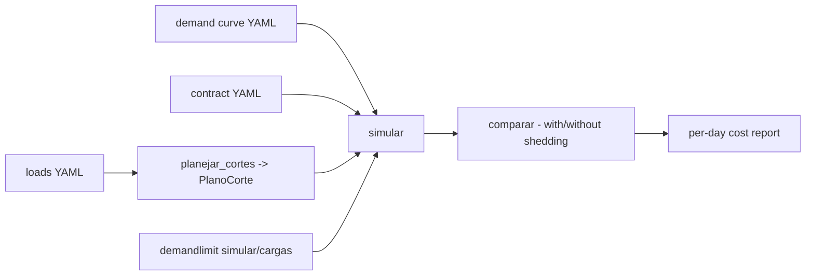

# demand-limiting

**English** · [Português (Brasil)](README.md)

[](#) [](#) [](#) [](LICENSE)

## What it is

**An electrical demand-management simulator**: it loads the **demand curve** and the **contract** (contracted demand, a tariff with peak/off-peak windows), **plans load shedding** (`PlanoCorte`), compares the daily cost **with and without shedding** by time band and produces a **report**. It is an educational lab for "branca"-style tariffs (energy + demand) in Python.

## Status

An educational lab, working and tested (50 tests).

## Features

- **Curve and contract** (`demanda.py`): `Curva` (a minute-by-minute demand series), `Contrato` (contracted demand); YAML.
- **Tariff** (`tarifa.py`): `Tarifa` with peak windows (`faixa_do_intervalo`), `custo_energia` and `custo_demanda` (contracted-demand overage).
- **Shedding** (`corte.py`): `Carga` (priority, max daily time), `planejar_cortes` builds a `PlanoCorte`.
- **Simulation** (`simulador.py`): `simular` estimates demand with the shedding applied; `comparar` yields a `Comparacao` with `PicoDia`; `ResultadoSimulacao`.
- **Report** (`relatorio.py`): `analisar_dias` + `gerar_relatorio` — cost per day (isolated × with shedding), formatted (`_formata_moeda`, `_formata_kw`).
- **CLI** (`demandlimit`): `simular` and `cargas`.

## Architecture

A `demandlimit` package with independent modules (demand, tariff, shedding, simulator, report) and `cli.py`.



## Stack

- Python ≥ 3.10
- PyYAML ≥ 6.0 (only dependency)
- pytest (dev)

## Repository layout

```
demand-limiting/
├── pyproject.toml · BRIEF.md
├── src/demandlimit/
│   ├── demanda.py · tarifa.py · corte.py
│   ├── simulador.py · relatorio.py · cli.py
├── dados/             # sample curve/contract/loads
├── tests/             # 50 tests
└── LICENSE            # MIT
```

## Prerequisites and installation

```bash
pip install -e .
```

## How to run

```bash
demandlimit simular dados/<scenario>.yaml
demandlimit cargas dados/cargas.yaml
```

## Tests and quality

Real command (verified by the agent):

```bash
PYTHONPATH=src python -m pytest tests/
# 50 passed
```

## Technical decisions and trade-offs

- **Simplified "branca" tariff model** (energy + demand): didactic; it does not cover distributed generation or tariff flags.
- **Priority-based shedding with a daily time cap**: a realistic curtailable-loads plan.

## Known limitations and roadmap

- Example scenarios; no real meter-data collection.
- For exact flags, see `demandlimit --help` (the parser is the reference).

## Development process

An individual project by Kelvin Oliveira, built with orchestrated AI agents and reviewed by the author.

## License and author

MIT — Copyright (c) 2026 Kelvin Rebelo de Oliveira. Author: [Kelvin Oliveira](https://github.com/KelvinOliveiraCode) · [Portfolio](https://kelvinoliveiracode.github.io/portfolio/)
