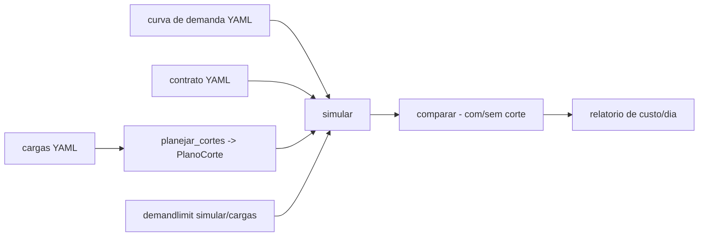

# demand-limiting

[English](README.en.md) · **Português (Brasil)**

[](#) [](#) [](#) [](LICENSE)

## O que é

**Simulador de gerenciamento de demanda elétrica**: carrega a **curva de demanda** e o **contrato** (demanda contratada, tarifa com janelas de ponta/fora), **planeja cortes de cargas** (`PlanoCorte`), compara o custo do dia **com e sem corte** por faixa horária e gera um **relatório**. É um laboratório educacional de tarifas tipo "branca" (energia + demanda) em Python.

## Status

Laboratório educacional funcional e testado (50 testes).

## Funcionalidades

- **Curva e contrato** (`demanda.py`): `Curva` (série de demanda por minuto), `Contrato` (demanda contratada); YAML.
- **Tarifas** (`tarifa.py`): `Tarifa` com janelas de ponta (`faixa_do_intervalo`), `custo_energia` e `custo_demanda` (ultrapassagem da contratada).
- **Cortes** (`corte.py`): `Carga` (prioridade, tempo máximo/dia), `planejar_cortes` monta um `PlanoCorte`.
- **Simulação** (`simulador.py`): `simular` estima a demanda com cortes aplicados; `comparar` gera um `Comparacao` com `PicoDia`; `ResultadoSimulacao`.
- **Relatório** (`relatorio.py`): `analisar_dias` + `gerar_relatorio` — custo por dia (isolado × com corte), formatado (`_formata_moeda`, `_formata_kw`).
- **CLI** (`demandlimit`): `simular` e `cargas`.

## Arquitetura

Pacote `demandlimit` com módulos independentes (demanda, tarifa, corte, simulador, relatório) e `cli.py`.



## Stack

- Python ≥ 3.10
- PyYAML ≥ 6.0 (única dependência)
- pytest (dev)

## Estrutura do repositório

```
demand-limiting/
├── pyproject.toml · BRIEF.md
├── src/demandlimit/
│   ├── demanda.py · tarifa.py · corte.py
│   ├── simulador.py · relatorio.py · cli.py
├── dados/             # exemplos de curva/contrato/cargas
├── tests/             # 50 testes
└── LICENSE            # MIT
```

## Pré-requisitos e instalação

```bash
pip install -e .
```

## Como executar

```bash
demandlimit simular dados/<cenario>.yaml
demandlimit cargas dados/cargas.yaml
```

## Testes e qualidade

Comando real (verificado pelo agente):

```bash
PYTHONPATH=src python -m pytest tests/
# 50 passed
```

## Decisões técnicas e trade-offs

- **Modelo tarifário branco simplificado** (energia + demanda): didático; não cobre Geração Distribuída ou bandeiras tarifárias.
- **Cortes por prioridade com tempo máximo/dia**: plano realista de carga desmultável.

## Limitações conhecidas e roadmap

- Cenários de exemplo; sem coleta de dados de medidor real.
- Detalhes das flags exatos: ver `demandlimit --help` (parser é a referência).

## Processo de desenvolvimento

Projeto individual de Kelvin Oliveira, construído com agentes de IA orquestrados e revisado pelo autor.

## Licença e autor

MIT — Copyright (c) 2026 Kelvin Rebelo de Oliveira. Autor: [Kelvin Oliveira](https://github.com/KelvinOliveiraCode) · [Portfólio](https://kelvinoliveiracode.github.io/portfolio/)
